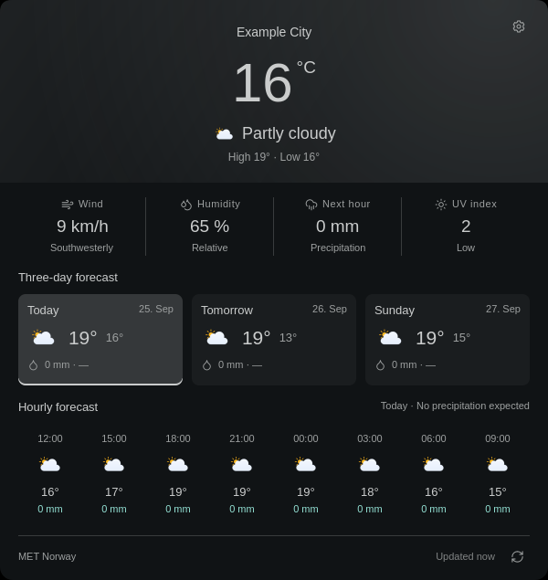

# Foamy Weather

Current weather and a three-day forecast.



## Install

Requires Omarchy 4.5 (it also loads on 4.0, in English), Bash, `curl`, `jq`,
`awk`, GNU coreutils, and `wl-paste` (wl-clipboard). Internet access is
required for forecasts and location search. For automatic location, install
GeoClue (`geoclue`). Disable another weather widget before enabling this one.

```sh
omarchy plugin add https://github.com/foamrider/foamy-weather.git --enable
```

## Use

1. Left-click the widget and open Settings (the cog, or `s`).
2. Search for a location and select a result, or turn on **Use location data**.
3. Choose units, and whether to animate the background.

Left-click opens the forecast, middle-click refreshes, and right-click shows a
summary notification. Select a day to see its hourly forecast.

Keyboard: arrow keys or `h`/`j`/`k`/`l` move one cursor over the day cards,
refresh and settings (moving onto a day selects it); Enter activates (with
nothing selected it opens Settings), `s` opens Settings, `r` refreshes, Esc
closes or leaves Settings, Tab and Shift+Tab switch to the next bar panel.
IPC: `omarchy-shell foamy.weather open|close|toggle|edit|refresh`.

The header shows the place, the temperature with the condition and today's
range, and a strip with wind, humidity, the next hour's precipitation and the
UV index, over an animated sky drawn from the current MET conditions (clouds
drift with the wind; calm weather and fog still move slowly).

When the location changes, the previous forecast stays visible, labelled with
its own place, until the new one arrives. The animated sky runs only while the
popup is open; with Omarchy's animations off (reduced motion) it is a still
image, and with CPU rendering or the `animations` setting off the plain header
is shown.

## Settings

Settings live in the widget's entry in `shell.json`. The popup sets the first
three; set the others with `omarchy bar set foamy.weather <key> <json> --json`.

| Key | Default | Meaning |
|---|---|---|
| `units` | `"metric"` | `"metric"` (°C, km/h, mm) or `"imperial"` (°F, mph, in) |
| `automaticLocation` | `false` | Use GeoClue for the location instead of the searched place |
| `animations` | `true` | Animated sky behind the current conditions |
| `refreshMinutes` | `30` | Forecast refresh interval, 5–1440 minutes |
| `locationRefreshMinutes` | `15` | Automatic-location refresh interval, 5–1440 minutes |
| `requestUserAgent` | `""` | User-Agent for MET Norway and OpenStreetMap requests (printable ASCII, 200 characters); empty uses `foamy-weather/<version> (+repository URL)` |

The searched location is stored in `~/.config/omarchy/weather-location.local.json`;
without one, the stock weather location (`~/.local/state/omarchy/settings/weather.json`)
is used.

## Privacy and network use

- Automatic positions are rounded to two decimals (about 1 km) before they are
  used, cached or sent anywhere. OpenStreetMap's Nominatim receives only that
  rounded position, at most once per new place per week, to name it.
- MET Norway receives coordinates rounded to three decimals (about 100 m).
- Coordinates and searched place names reach `curl` through stdin, never
  process arguments. Cache names use opaque hashes; caches are owner-only.
  The current automatic position is kept in `$XDG_RUNTIME_DIR` only; without
  a private runtime directory automatic location reports an error instead of
  using `/tmp`.
- Forecasts follow MET's terms: the `Expires` header decides when to ask
  again (30 minutes when absent), refreshes send `If-Modified-Since`, and a
  forced refresh (middle-click, the refresh button) waits at least 60 seconds
  between downloads. Requests identify the plugin with a User-Agent.
- Forecast responses are limited to 2 MiB and each sunrise response to 64 KiB
  after decompression; invalid or oversized responses are rejected and a
  valid cached forecast stays available. Requests wait briefly after the
  network connects and retry temporary failures up to three times with
  increasing delays.
- One shell runs one set of requests and timers, however many monitors show
  the bar.
- Location-search paste is limited to 16 KiB and two seconds.

## Remove

```sh
omarchy plugin remove foamy.weather
```

When removing an enabled replacement, Omarchy restores `omarchy.weather`.
Location settings, forecast preferences, and cached forecasts remain on disk.
Some settings are shared with the stock weather plugin; retain them if you
intend to use it. GeoClue remains installed.

Omarchy manages the plugin entry in `shell.json`. Packages and data outside
the plugin directory are retained unless you remove them separately.

## License

Weather: [MET Norway](https://www.met.no/), [CC BY 4.0](https://creativecommons.org/licenses/by/4.0/).
Search: [Open-Meteo](https://open-meteo.com/) / GeoNames.
Automatic location names: [OpenStreetMap contributors](https://www.openstreetmap.org/copyright).

Code: [MIT](LICENSE). Third-party notices:
[Omarchy](LICENSE-OMARCHY), [Atmosphere](LICENSE-ATMOSPHERE),
[Meteocons](LICENSE-METEOCONS), and [Lucide](kit/LICENSE-LUCIDE).
Shared components: [foamy-kit](https://github.com/foamrider/foamy-kit) (MIT), copied into `kit/`.

Provided **as is**, without warranty or guaranteed support. Use at your own risk.

Language follows **Omarchy → Setup → Language** on Omarchy 4.5 (English and
Norwegian catalogs; others fall back to English). Omarchy 4.0 displays the
plugin in English.

## Development

`kit/` holds shared components copied from [foamy-kit](https://github.com/foamrider/foamy-kit); edit them there, not here.

```sh
for t in tests/*.test.js tests/i18n.test.cjs; do node "$t"; done
python3 -m unittest tests.test_clipboard tests.test_location_privacy
bash tests/test-weather-location.sh
bash tests/kit-check.sh
python3 tests/i18n-runtime.py                  # OMARCHY_PATH=<4.5 tree> for 4.5
python3 tests/runtime.py                       # needs foamy-kit (FOAMY_KIT)
python3 tests/sky-gpu.py                       # the sky on a GPU (eglfs on a render node); skips without one
```

`preview/Preview.qml` renders mock states with the foamy-kit preview harness.
