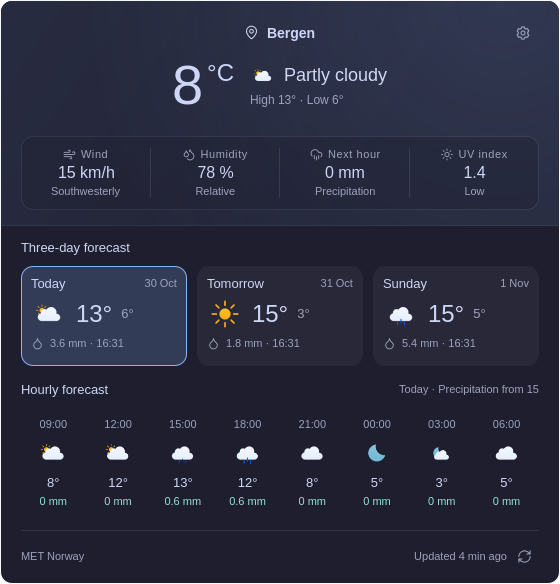

# Foamy Weather

Current weather and a three-day forecast.



## Install

Requires Omarchy 4.5, Bash, and, for
pasting into the location search, `jq`, GNU coreutils and `wl-paste`
(wl-clipboard). Forecasts, location search and place names come from the
plugin's bundled helper, `bin/<arch>/foamy-weather-helper` (static binaries for
x86-64 and AArch64 Linux; no `curl`, Python or other runtime). Its HTTPS needs
AES, carry-less multiply, AVX2, BMI2 and ADX on x86-64 (Intel Broadwell, AMD
Zen or newer), or the crypto extensions on ARMv8 (a Raspberry Pi 5, not a
Pi 4); without them the widget says HTTPS isn't supported on this CPU instead
of loading weather. Internet access is required for forecasts and location
search; `https_proxy`/`all_proxy` (HTTP proxies) and `no_proxy` are honoured.
For automatic location, install GeoClue (`geoclue`; its `where-am-i` demo is
used). Disable another weather widget before enabling this one.

```sh
omarchy plugin add https://github.com/foamrider/foamy-weather.git --enable
```

## Use

1. Left-click the widget and open Settings (the cog, or `s`).
2. Search for a location and select a result, or turn on **Use location data**.
3. Choose units, and whether to animate the background.

Left-click opens the forecast, middle-click refreshes, and right-click shows a
summary notification. Select a day to see its hourly forecast.

Keyboard: arrow keys or `h`/`j`/`k`/`l` move one cursor over the day cards,
refresh and settings (moving onto a day selects it); Enter activates (with
nothing selected it opens Settings), `s` opens Settings, `r` refreshes, Esc
closes or leaves Settings, Tab and Shift+Tab switch to the next bar panel.
IPC: `omarchy-shell foamy.weather open|close|toggle|edit|refresh` (`show` and
`hide` are aliases of `open` and `close`), and `current` (below).

The header shows the place, the temperature with the condition and today's
range, and a strip with wind, humidity, the next hour's precipitation and the
UV index, over an animated sky drawn from the current MET conditions (clouds
drift with the wind; calm weather and fog still move slowly).

When the location changes, the previous forecast stays visible, labelled with
its own place, until the new one arrives. The animated sky runs only while the
popup is open; with Omarchy's animations off (reduced motion) it is a still
image, and with CPU rendering or the `animations` setting off the plain header
is shown.

## Service and `current()`

The plugin also has a `service` entry (`Service.qml`), so other plugins (the
Foamy lock screen's weather) can ask for the current weather without a bar
widget. Omarchy loads it whenever `foamy.weather` is enabled: through its bar
widget, or through an entry in `plugins[]` in `shell.json` with the keys from
[Settings](#settings):

```json
{ "id": "foamy.weather", "units": "metric", "automaticLocation": false, "requestUserAgent": "" }
```

The service does nothing until it is asked. A `current()` call starts it, and
it stops 30 minutes after the last call; a bar widget keeps it running as
before. Widgets and the service share one forecast, one set of requests and
one IPC target: the service answers `foamy.weather` while it is loaded (the
popup functions reach the widget's popup and do nothing without one), and the
widget answers only when no service is loaded. Settings come from the widget
while one exists, else from the `plugins[]` entry, else from the bar entry.
The service only reads `shell.json`.

`omarchy-shell foamy.weather current` (or, from a plugin, foamy-kit's
`FoamyPeerIpc`) returns one line of JSON and never waits for the network:

```json
{"ok":true,"temperature":6,"unit":"C","code":"lightrain","condition":"Light rain","high":10,"low":2,"location":"Bergen","updatedAt":"2026-11-08T08:30:00.000Z"}
{"ok":false,"reason":"pending"}
```

| Field | Meaning |
|---|---|
| `temperature`, `high`, `low` | Whole degrees in `unit`; `high`/`low` are today's range (`null` when unknown) |
| `unit` | `"C"` (`units: "metric"`) or `"F"` (`"imperial"`) |
| `code` | MET Norway's symbol code (`[a-z0-9_]`, at most 48 characters, such as `partlycloudy_night`); anything else reads as `cloudy` |
| `condition` | The condition in the shell's language (Omarchy → Setup → Language), at most 64 characters |
| `location` | The forecast's place name, at most 80 characters (show it only if your user wants it) |
| `updatedAt` | When the forecast was downloaded, UTC ISO 8601 (`""` when unknown); the data may be hours old when MET or the network is unavailable |

`reason` is `pending` (starting, loading, retrying or resolving the automatic
location: ask again in a few seconds), `no-location` (no place chosen, or
automatic location failed), `offline`, `unsupported` (no helper or HTTPS for
this CPU) or `error` (the download failed). Strings are single-line plain
text. A cold start answers `pending` for about 2 seconds while the network
settles, then until the download ends: usually a second or two, at most
about 35 seconds when MET is slow (10 s for the forecast, then up to 8 s for
each of three sunrise requests). The sunrise requests stop at the first one
that fails and are skipped when the forecast download failed, so a dead
network costs one deadline, not four. A cached forecast answers at once.

## Settings

Settings live in the widget's entry in `shell.json` (or the `plugins[]` entry,
for the service). The popup sets the first three; set the others with
`omarchy bar set foamy.weather <key> <json> --json`.
A stored value outside these rules (a string, or out of range) reads as the
default, as the popup would refuse it.

| Key | Default | Meaning |
|---|---|---|
| `units` | `"metric"` | `"metric"` (°C, km/h, mm) or `"imperial"` (°F, mph, in) |
| `automaticLocation` | `false` | Use GeoClue for the location instead of the searched place |
| `animations` | `true` | Animated sky behind the current conditions |
| `refreshMinutes` | `30` | Forecast refresh interval, 5–1440 minutes |
| `locationRefreshMinutes` | `15` | Automatic-location refresh interval, 5–1440 minutes |
| `requestUserAgent` | `""` | User-Agent for MET Norway and OpenStreetMap requests (printable ASCII, 200 characters); empty or blank uses `foamy-weather (+repository URL)` |

The searched location is stored, owner-only, in
`~/.local/state/omarchy/settings/foamy-weather-location.json` (under
`$XDG_STATE_HOME` when set); without one, the stock weather location
(`weather.json` in the same directory) is used. Earlier versions kept it in
`~/.config/omarchy/weather-location.local.json`: when the widget starts, a
valid file there is copied to the new place, checked, and then removed. If
both exist the new file wins; the old one is removed only when it holds the
same place, so a different or invalid old file is left alone.

## Privacy and network use

- Automatic positions are rounded to two decimals (about 1 km) before they are
  used, cached or sent anywhere. OpenStreetMap's Nominatim receives only that
  rounded position, at most once per new place per week, to name it.
- MET Norway receives coordinates rounded to three decimals (about 100 m).
- Coordinates and searched place names reach the helper through stdin, never
  process arguments. Cache names use opaque hashes; caches are owner-only.
  The current automatic position is kept in `$XDG_RUNTIME_DIR` only; without
  a private runtime directory automatic location reports an error instead of
  using `/tmp`.
- Forecasts follow MET's terms: the `Expires` header decides when to ask
  again (30 minutes when absent), refreshes send `If-Modified-Since`, and a
  forced refresh (middle-click, the refresh button) waits at least 60 seconds
  between downloads. Requests identify the plugin with a User-Agent.
- Forecast responses are limited to 2 MiB and each sunrise response to 64 KiB
  after decompression (place names and search results to 256 KiB); invalid
  or oversized responses are rejected and a valid cached forecast stays
  available. Each request has a fixed deadline (3 seconds to connect; 10
  seconds for a forecast, 8 for sunrise or a place name, 5 for a search).
  Requests wait briefly after the network connects and retry temporary
  failures up to three times with increasing delays.
- One shell runs one set of requests and timers, however many monitors show
  the bar. Without a bar widget nothing is requested until a `current()` call,
  and nothing after 30 minutes without one.
- Location-search paste is limited to 16 KiB and two seconds.

## Verifying the helper binaries

`bin/x86_64/foamy-weather-helper` and `bin/aarch64/foamy-weather-helper` are compiled from the Rust source in this repository: `native/`, the
shared crate in `kit/rust/`, the dependencies locked in `Cargo.lock` and the
toolchain pinned in `rust-toolchain.toml`, with the build tool in
`kit/native/`. The build is reproducible. `native/native.pin` records the
toolchain, a hash of every build input (`source`) and the SHA-256 of each
binary.

**CI.** The [Verify native helpers](https://github.com/foamrider/foamy-weather/actions/workflows/verify-native.yml)
workflow rebuilds both binaries on a GitHub-hosted runner for every push,
compares them byte for byte with `bin/`, and attests the rebuilt files. To
check the committed files against that attestation (GitHub CLI):

```sh
gh attestation verify bin/x86_64/foamy-weather-helper --repo foamrider/foamy-weather \
  --signer-workflow foamrider/foamy-weather/.github/workflows/verify-native.yml \
  --deny-self-hosted-runners
gh attestation verify bin/aarch64/foamy-weather-helper --repo foamrider/foamy-weather \
  --signer-workflow foamrider/foamy-weather/.github/workflows/verify-native.yml \
  --deny-self-hosted-runners
```

Add `--source-digest <commit>` to require a particular commit.

**Yourself.** You need `rustup`, Python 3.11 or newer and `file`. From a
checkout of this repository at the commit you want to check:

```sh
rustup toolchain install "$(awk '$1 == "toolchain" { print $2 }' native/native.pin)" \
  --profile minimal --target x86_64-unknown-linux-musl,aarch64-unknown-linux-musl
kit/native/build-native.sh . --verify
```

It builds both binaries from scratch in `~/.cache/foamy-native/` (nothing is
written to the checkout), compares them byte for byte with `bin/`, checks
that the kit files are unmodified and that `native.pin` matches the source,
and ends with `verify OK (foamy-weather-helper, <toolchain>, both arches reproducible)`.

### Building the helper yourself

To run binaries you built instead of the committed ones, build them in the
installed plugin with the same toolchain, then run `omarchy restart shell`:

```sh
cd ~/.config/omarchy/plugins/foamy.weather
kit/native/build-native.sh .
```

The build is reproducible, so `git status` shows no change when your
binaries match the release, and `omarchy plugin update` still applies.

## Remove

```sh
omarchy plugin remove foamy.weather
```

When removing an enabled replacement, Omarchy restores `omarchy.weather`.
Location settings, forecast preferences, and cached forecasts
(`~/.cache/omarchy-weather/`) remain on disk.
Some settings are shared with the stock weather plugin; retain them if you
intend to use it. GeoClue remains installed.

Omarchy manages the plugin entry in `shell.json`. Packages and data outside
the plugin directory are retained unless you remove them separately.

## License

Weather: [MET Norway](https://www.met.no/), [CC BY 4.0](https://creativecommons.org/licenses/by/4.0/).
Search: [Open-Meteo](https://open-meteo.com/) / GeoNames.
Automatic location names: [OpenStreetMap contributors](https://www.openstreetmap.org/copyright).

Code: [MIT](LICENSE). Third-party notices:
[Omarchy](LICENSE-OMARCHY), [Atmosphere](LICENSE-ATMOSPHERE),
[Meteocons](LICENSE-METEOCONS), and [Lucide](kit/LICENSE-LUCIDE).
Shared components: [foamy-kit](https://github.com/foamrider/foamy-kit) (MIT), copied into `kit/`.

Provided **as is**, without warranty or guaranteed support. Use at your own risk.

Language follows **Omarchy → Setup → Language** on Omarchy 4.5 (English and
Norwegian catalogs; others fall back to English).

## Development

`kit/` holds shared components copied from [foamy-kit](https://github.com/foamrider/foamy-kit); edit them there, not here.

The helper's source is `native/` (Rust; its contract is the doc comment at the
top of `native/src/main.rs`). Rebuild both binaries and `native/native.pin`
with the build tool in `kit/native/` after any change there, in `kit/rust/` or
in `Cargo.lock`, and commit them together:

```sh
export CARGO_TARGET_DIR=~/.cache/foamy-native/foamy-weather   # never inside the plugin
kit/native/build-native.sh . --test    # fmt, clippy, unit tests
kit/native/build-native.sh .           # bin/x86_64, bin/aarch64, native.pin
kit/native/build-native.sh . --verify  # clean rebuild, byte-identical
```

The animated sky's shaders are compiled: after changing `shaders/*.frag` or
`*.vert`, run `scripts/build-atmosphere.sh` (needs Qt's `qsb`) and commit the
`.qsb` files.

The tests (Python 3, Node, `openssl` and qemu-user for AArch64; development
only) run the helper as a process, `bin/<arch>/foamy-weather-helper` or the
JSON argv prefix in `FOAMY_HELPER`, against a loopback HTTPS stand-in for MET
Norway, Nominatim and Open-Meteo with a throwaway CA (`tests/fakenet.py`; the
helper's test-only `FOAMY_WEATHER_TEST_CONNECT` and `SSL_CERT_FILE`). Nothing
is sent to the real services, and all files go to temporary HOME/XDG
directories.

```sh
for t in tests/*.test.js tests/i18n.test.cjs; do node "$t"; done   # service.test.js: current() and the entry
python3 -m unittest tests.test_clipboard tests.test_location_privacy
bash tests/test-weather-location.sh
FOAMY_HELPER="[\"$PWD/bin/aarch64/foamy-weather-helper\"]" node tests/weather-fetch.test.js   # and the two above
bash tests/kit-check.sh
python3 "$FOAMY_KIT/preview/i18n_runtime.py" .  # live language switching (foamy-kit's shared check)
python3 tests/runtime.py                       # needs foamy-kit (FOAMY_KIT)
python3 tests/search-runtime.py                # the location search; needs foamy-kit
python3 tests/fetch-runtime.py                 # the forecast fetch across place changes; needs foamy-kit
python3 tests/sky-gpu.py                       # the sky on a GPU (eglfs on a render node); skips without one
```

The offscreen tests run on Omarchy 4.5, the installed `/usr/share/omarchy/shell`
(`FOAMY_HOST_45` picks another 4.5 tree).

`preview/Preview.qml` renders mock states with the foamy-kit preview harness
(`FOAMY_HOST_45=/usr/share/omarchy/shell <foamy-kit>/preview/render.py . --host 4.5`).
